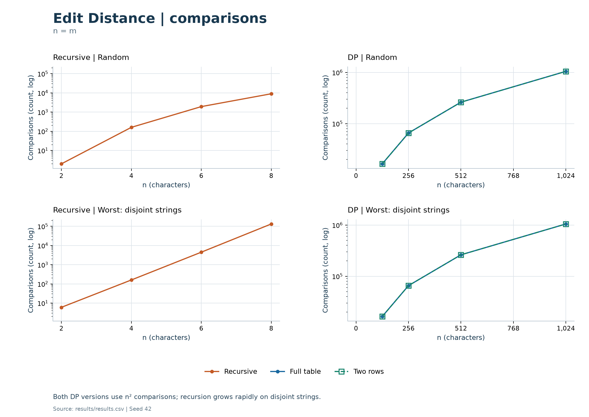
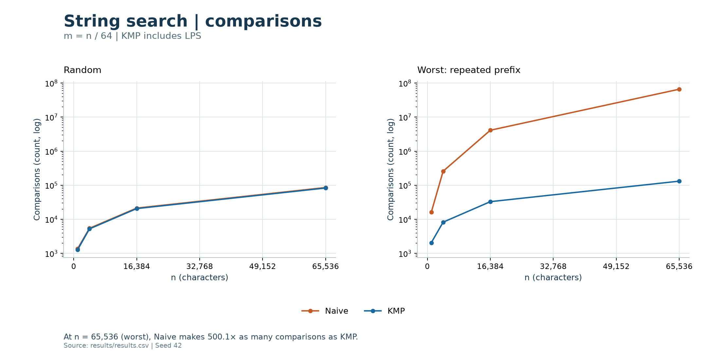
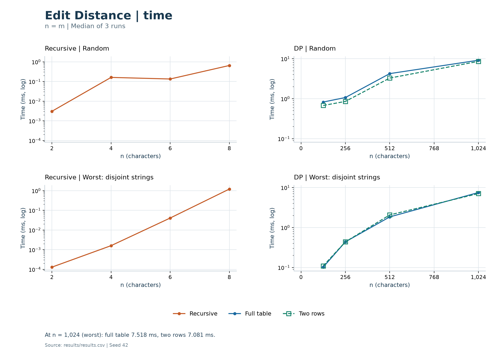
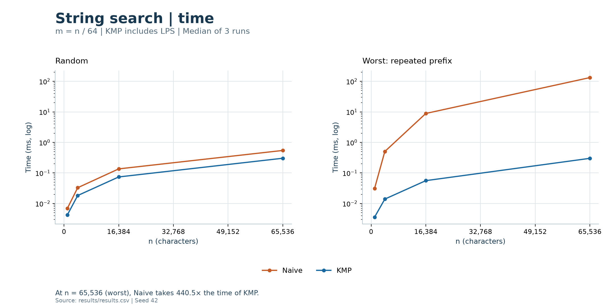

# Assignment 4: Dynamic Programming and String Algorithms

## 1. Experiment Design Card

| Item | Choice and reason |
|---|---|
| Questions | Edit Distance: how does recursive work grow, and do both DP versions make equal comparisons? Search: how do Naive and KMP scale on random and difficult inputs? |
| Sizes | Recursive: `2, 4, 6, 8`. Table / TwoRows: `128, 256, 512, 1024`. Both edit strings have length `n`. Search: `n = 1024, 4096, 16384, 65536`, `m = n/64`. Small sizes keep recursion manageable; larger sizes expose DP and search growth. |
| Edit inputs | Random strings over `ABCD`; disjoint strings `A^n` / `B^n` force all three recursive branches. |
| Search inputs | Random text/pattern over `ABCD`; text `A^n` and pattern `A^(m-1)B` force Naive to fail at the end of every candidate. |
| Metrics | Character comparisons counted inside algorithms, including KMP preprocessing, measure work. Median time in milliseconds measures practical cost. |
| Runs | Seed `42`; JVM warm-up, then three warm-up calls and three measured calls per case. Input generation and CSV writing are outside timing. Inputs and counts are reproducible; times vary. |
| Predictions | Recursive edit grows exponentially; DP comparisons grow as `n²`. Random search is approximately linear; the chosen worst case is quadratic for Naive and linear for KMP because `m` grows with `n`. |
| Plots | Comparison counts and median times versus `n` for each family, split by input type, using a linear X axis with evenly spaced ticks and a logarithmic Y axis. |
| Revision | The initial plan preceded measurement. To reduce scope, five measured runs became three and each algorithm retained four sizes; measurements were rerun. |

Data: [results/results.csv](results/results.csv), **120 rows = 5 algorithms × 2 input types × 4 sizes × 3 runs**. Recursive and DP sizes differ, so their times are not directly comparable.

## 2. Comparison counts

**Figure 1.** DP curves overlap at `n²` comparisons; recursive work grows sharply on disjoint strings.

**Figure 2.** At `n = 65,536` on the repeated-prefix input, Naive makes approximately **500.1 times** as many comparisons as KMP.

## Prediction versus result

| Algorithm | Prediction | Observation and conclusion |
|---|---|---|
| Recursive edit | Exponential worst-case growth | Disjoint-input comparisons rise from 6 at `n = 2` to 132,864 at `n = 8`, consistent with branching. |
| Table / TwoRows | Quadratic comparisons | Both reach 1,048,576 comparisons at `n = 1024`; doubling `n` multiplies counts by four. |
| Naive | Near-linear random search; quadratic chosen worst case | Increasing `n` and `m` fourfold multiplies worst-case counts by about sixteen; random counts grow roughly fourfold. |
| KMP | Linear search including LPS | Increasing `n` fourfold increases comparisons roughly fourfold for both input types. |

## 3. Measured time

**Figure 3.** At `n = 1024` on disjoint strings, Table takes **7.518 ms** and TwoRows takes **7.081 ms** despite equal comparison counts.

**Figure 4.** At `n = 65,536` on the repeated-prefix input, Naive takes **132.725 ms** versus **0.301 ms** for KMP, approximately **440.5 times** longer.

Time is affected by JVM warm-up, allocation and background load. Random recursion takes 0.162 ms at `n = 4` but 0.134 ms at `n = 6`, despite more comparisons; small timings are noisy. TwoRows is not always faster: at `n = 512` on disjoint strings it takes 2.069 ms versus Table's 1.844 ms. Medians reduce outlier effects, but comparison counts remain the main evidence for growth.

## 4. Short answers

| Question | Answer |
|---|---|
| Which input made search slowest, and why? | The repeated-prefix input was slowest for Naive because each candidate fails only after `m` comparisons. Its work is `(n-m+1)*m`, while KMP reuses prefix information. This input increased KMP's comparisons but not consistently its time: the largest case took 0.301 ms versus 0.303 ms for random input. |
| How large an `n` could recursion handle, and what stopped it? | The largest tested size in the final experiment was `n = m = 8`, taking 132,864 comparisons and 1.205 ms on disjoint strings. The experiment stopped at its chosen size limit, not a crash or timeout. This is not a measured technical maximum; larger sizes were excluded because recursive branching grows exponentially. |
| What is gained and lost with two rows? | Auxiliary memory drops from `O(n*m)` to `O(m)`. The distance and quadratic time bound remain unchanged. Discarding older rows prevents direct backtracking through the full table to recover edit operations, although returning only the distance still works. |
| Which search would you choose for the city platform? | I would choose KMP for long logs that may contain repetitive text. Its `O(n+m)` bound includes preprocessing and avoids Naive's repeated checks. Our difficult-input results support this choice but do not prove KMP is faster on every input. |

| Validation | Result |
|---|---|
| JUnit | All 44 test cases passed: reference values, boundaries, overlaps, random cross-checks, counters and experiment output. |
| Scope | Generated search inputs had no matches; successful and overlapping matches were verified in tests. |
